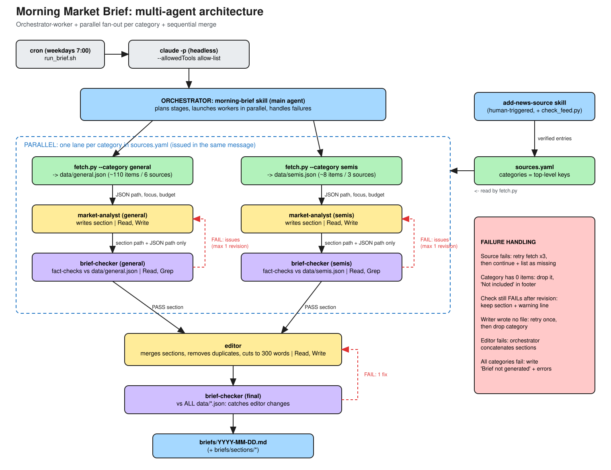

# Module 4: Multi-Agent Architecture



Diagram source: [docs/architecture.excalidraw](docs/architecture.excalidraw)
(open at [excalidraw.com](https://excalidraw.com) → menu → Open). Generated by
[docs/make_diagram.py](docs/make_diagram.py).

## What changed

Through Module 3 the brief covered one category: one writer and one checker. Module 4
adds the step the original project brief deferred: **multiple news categories**
(`general` + new `semis`) merged by an **editor**. Each category is an
independent unit of work, so this is where a multi-agent design pays off.

## Architecture: orchestrator-worker, with parallel lanes and a sequential merge

1. **Orchestrator** (`morning-brief` skill, main agent) plans the stages and
   owns failure handling. It never writes brief content itself.
2. **Parallel fan-out:** one lane per category (fetch → write → check →
   optional revise). Lanes share nothing, so every stage runs for all
   categories at once (tool calls in the same message).
3. **Sequential handoff:** the editor needs every section, then a final
   checker verifies the editor's output.

**Why this and not the alternatives**

| Option | Why not (alone) |
|---|---|
| One agent does everything | Context fills with ~120 items for every category plus every check; no independent verification; categories are processed serially |
| Pure parallel agents, no orchestrator | Someone must merge, dedupe, enforce length, and decide what to do when a lane fails |
| Agent team (peers messaging each other) | Overkill: lanes don't need to talk to each other. Their only overlap is duplicate stories, which a single editor pass resolves |
| Each lane as a nested "category desk" agent that calls its own writer/checker | Claude Code subagents can't spawn subagents, so the orchestrator drives each stage across lanes |

## Components

| Component | Type | Responsibility | Inputs | Context it sees | Tools | Output | Depends on |
|---|---|---|---|---|---|---|---|
| `run_brief.sh` | script (cron) | Start a headless run with a tool allow-list | none | none | n/a | `logs/DATE.log` | cron |
| `morning-brief` | **orchestrator** skill | Plan stages, launch lanes in parallel, retry, handle failures, report | `sources.yaml` keys, date | Its skill + verdicts/reports from workers (not their working context) | Skill, Agent, Read, Write, Bash (only `fetch.py`, `pip install`, `date`) | Final report | everything below |
| `fetch.py` | script | Pull last N hours for one category, dedupe, report failed sources | `--category`, `--hours` | n/a | n/a | `data/<cat>.json` (`items`, `errors`) | `sources.yaml`, RSS/YouTube |
| `market-analyst` ×N | subagent (worker) | Write one category section within a word budget | category, focus, JSON path, output path, budget | Only its category JSON | Read, Write | `briefs/sections/DATE-<cat>.md` | fetch |
| `brief-checker` ×N+1 | subagent (worker) | Independently verify facts, citations, no advice, disclosure, length | brief/section path, JSON path(s), word limit | Only the text + raw data, **never** the writer's reasoning | Read, Grep (read-only) | `VERDICT: PASS/FAIL` + issues | analyst / editor |
| `editor` | subagent | Merge sections, dedupe cross-category stories, cut to length | section paths (priority order), date, limit, dropped categories | Only the checked sections | Read, Write | `briefs/DATE.md` | all lanes |
| `add-news-source` | skill (human-triggered) | Find + verify + add sources/categories | source name, category | `sources.yaml`, `check_feed.py` output | Read, Edit, Bash (python, curl), WebFetch | updated `sources.yaml` | none; runs outside the daily pipeline |

## Handoffs

| From → To | What is passed | Why only that |
|---|---|---|
| Orchestrator → `fetch.py` ×N (parallel) | category, hours, out path | |
| Orchestrator → `market-analyst` ×N (parallel) | category, focus, JSON **path**, output path, budget, lookback | Paths, not content: the worker reads the data itself, so the orchestrator's context stays small |
| Orchestrator → `brief-checker` ×N (parallel) | section path + JSON path + limit, **nothing else** | Independence: the checker can't be persuaded by the writer's intent |
| `brief-checker` → `market-analyst` (via orchestrator) | the checker's issue list, verbatim | Writer fixes exactly what failed; no paraphrase drift |
| Orchestrator → `editor` | section paths in priority order, limit, dropped categories + reasons | Editor may only cut / reorder / merge. It can't add facts because it never sees raw data |
| Orchestrator → final `brief-checker` | merged brief + **all** category JSONs | Catches anything the editor changed |

**Combining results.** Each writer ends its section with a machine-readable
`<!-- sources: N items from M sources. missing: ... -->` comment. The editor
sums these into one footer and merges "Also on the radar" lines. Cross-category
duplicates (e.g. Nvidia news in both Market and Semis) are expected, because writers
can't see each other's work. The editor keeps each story once, in the more relevant section.

## Failure handling

| Failure | Response | Result in the brief |
|---|---|---|
| A source fails (e.g. YouTube 404) | Retry that category's fetch up to 3×; continue with partial data | "Missing sources: …" |
| A whole category returns 0 items | Drop the category; other lanes continue | "Not included: semis (reason)" |
| Section FAILs its check | 1 revision with the checker's issues → re-check | If still FAIL: section kept + `⚠️ Fact-check failed` line |
| Writer produces no file | Retry once, then drop the category | "Not included: … (writer failed)" |
| Editor fails | Orchestrator concatenates the checked sections | "(unedited: editor failed)" |
| Final check FAILs | 1 editor fix → re-check | ⚠️ line if still failing |
| Every category fails | Stop | "Brief not generated" + errors |

All loops are capped at one retry, so a run always finishes.

## Results ([examples/multi-agent-run.md](examples/multi-agent-run.md))

Two headless runs on 2026-09-29. Traces show the orchestrator issuing
**fetch, write, and check for both categories in the same message** (parallel):

```
fetch.py general   ||  fetch.py semis
market-analyst general  ||  market-analyst semis
brief-checker general   ||  brief-checker semis
market-analyst: revise general          ← run 1 only: general FAILED (unsupported "PCE", misleading China wording)
brief-checker: re-check general         ← PASS
editor: merge
brief-checker: final                    ← PASS (22/22 facts)
```

- Run 1: 255 s, $1.88. General section failed its check, was revised, then passed.
- Run 2: 218 s, $1.41. CNBC TV YouTube feed 404'd 3×, so the brief continued with 5/6 sources and disclosed the missing one.
- Output: [briefs/2026-09-29.md](briefs/2026-09-29.md) with Market + Semis sections,
  110 items from 7 sources, ~275 words.
- The `semis` category was created by the `add-news-source` skill (Module 2)
  evaluating 5 candidates and adding 3 ([log](examples/add-semis-category-run.md)),
  with no code changes.

## Trade-offs and next steps

- **Cost/time:** ~$1.40-1.90 and ~4 min per run, vs ~1 min single-agent.
  Most of it is the checkers. Acceptable for one run a day; could use a
  cheaper model for the checkers.
- **Semis coverage is thin** (~8 items/day from engineering-focused feeds).
  Next: find a more market-focused chip-news source with `add-news-source`.
- **Adding a category** = `add-news-source` + one row (title, focus,
  budget) in the orchestrator's category table.
